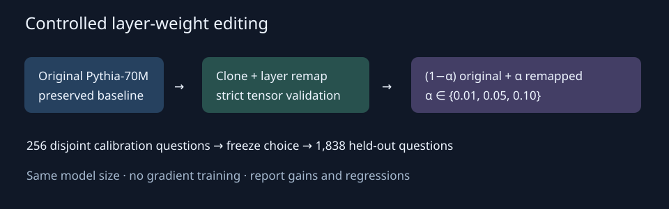
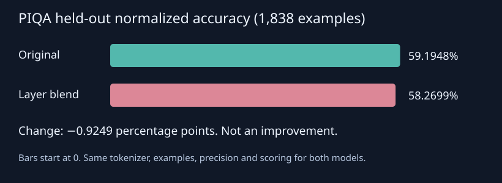

# Bounded layer-weight editing: Pythia-70M × PIQA

**Completed negative result: the validation-selected edit reduced held-out accuracy. Keep the original model for use.**

This experiment extends MergeKit with a strict, non-mutating raw-state-dict layer remapper, then tests small interpolations between Pythia's original weights and rearranged copies. It does not train, rent compute, change an active service, or overwrite the source checkpoint.

## Provenance
- Upstream toolkit: [arcee-ai/mergekit](https://github.com/arcee-ai/mergekit), pinned `0f1423ecf0f06f46f17b045b333b6c445705390e`; LGPL-3.0-only. The fork retains upstream attribution and license.
- Model: [EleutherAI/pythia-70m](https://huggingface.co/EleutherAI/pythia-70m), pinned `a39f36b100fe8a5377810d56c3f4789b9c53ac42`; Apache-2.0.
- Original release [PIQA result](https://github.com/EleutherAI/pythia/blob/main/evals/pythia-v1/pythia-70m/zero-shot/70m_step143000.json): accuracy 59.4668%, character-normalized accuracy 59.1404%. Our unchanged baseline must be measured under our own identical settings; the historical number is context, not our control.
- [PIQA](https://yonatanbisk.com/piqa/) data from the authors' repository, with exact input hashes in protocol.json. Data is downloaded, not redistributed here.
- Formatting follows [LM Evaluation Harness v0.3.0 PIQA](https://github.com/EleutherAI/lm-evaluation-harness/blob/v0.3.0/lm_eval/tasks/piqa.py): `Question: {goal}\nAnswer:` followed by a space and each solution. Scores sum continuation token log probabilities; normalized scores divide by solution character length.

## Fixed experiment

Two rearrangements: swap middle layers 2/3, or replace each layer by the next (last stays last). Interpolate original/remapped tensors with alpha 0.01, 0.05, or 0.10 using MergeKit's linear method. Depth, parameter count, tokenizer and evaluation budget stay unchanged. This is a small controlled search, **not a claim of a new general merging algorithm**.

Calibration: first 256 training examples whose question goals do not appear in official validation. Select by normalized calibration accuracy, ties preferring identity then listed order. The best nonidentity candidate is also evaluated as an experimental challenger if identity wins. All 1,838 official validation examples are held out until selection is frozen. Publish every candidate and both final metrics, including regressions, plus paired example-level bootstrap intervals. Selection success is not guaranteed.

An initial calibration-only run was stopped after an audit found eight shared question goals between its first 256 training examples and validation. There were no identical full examples; nevertheless all heldout-goal matches are excluded in the restarted protocol. No heldout scores were observed before this correction. Original traces are retained privately for audit.

Ten remapping regression tests passed locally: identity/no aliasing, permutations, repeated donor independence, invalid indices/depth, shape/dtype/key mismatch and custom prefixes. Raw shape compatibility does not establish functional compatibility. The run uses CPU float32 and two threads. No claim about 888B scalability or general intelligence follows from this pilot.

## Reproduce

Install the fork at this branch and its dependencies in an isolated environment. Download `train.jsonl`, `train-labels.lst`, `valid.jsonl`, and `valid-labels.lst` from the PIQA authors' data directory; verify protocol hashes. Run `python pilot.py` beside these files. The model revision is pinned in the script. Use the same Torch/Transformers versions recorded with final results. See the completed results below.

## Completed results

| Metric | Untouched baseline | Selected edit | Difference |
|---|---:|---:|---:|
| Calibration normalized accuracy (256) | 58.9844% | 59.3750% | +0.3906 pp |
| Held-out accuracy (1,838) | 59.8477% | 59.3580% | −0.4897 pp |
| Held-out normalized accuracy (1,838) | 59.1948% | 58.2699% | −0.9249 pp |

The selected candidate mixes 95% original weights with 5% of the copy whose layers 2 and 3 are swapped. It won only **one extra calibration example**, tied another candidate and won the preregistered candidate-order tiebreak. That tiny apparent gain did not generalize. Paired normalized decisions: 24 wins, 41 losses. Example-level bootstrap 95% interval for the difference: **−1.7954 to −0.0544 percentage points**. This interval ignores source/topic correlation and cannot establish universal degradation.

The original release reports 59.4668% raw / 59.1404% normalized accuracy. Our reproduced baseline differs by +0.3808 / +0.0544 pp. We used CPU FP32 with contemporary Torch/Transformers rather than the release's GPU harness setup, so this is a matched controlled comparison, not bit-identical reproduction of its historical run. The historical score was not used to choose the edited model.

Original cache files: all 16 audited hashes unchanged. Exported checkpoint: 76 tensors exactly equal to a fresh reconstruction of the selected MergeKit transformation; reload logits agree exactly on a smoke input. No live 888B weights were changed.

Runtime: Torch 2.10.0+cpu, Transformers 4.57.6, safetensors 0.7.0, NumPy 2.2.6. MergeKit source commit above. Although current upstream metadata requests newer Transformers, its in-memory linear API worked with this recorded environment; this experiment does not certify full upstream compatibility. All seven calibration candidates and both held-out prediction arrays are retained in results.json. No held-out retuning was performed.

### Interpretation

Layer interpolation is a valid weight-editing experiment, but this result **does not improve Pythia**. Shape compatibility and a small calibration gain are inadequate selection evidence. A future independent run should use larger calibration data, stronger uncertainty thresholds, and representation-aligned donors before another untouched evaluation. This dataset is now observed and must not be portrayed as fresh confirmation after further tuning.

The checkpoint is an explicitly labelled **negative-result research artifact**, not a recommended replacement or state-of-the-art model. Original Pythia limitations, biases and license apply. No new general-purpose capability is claimed.
